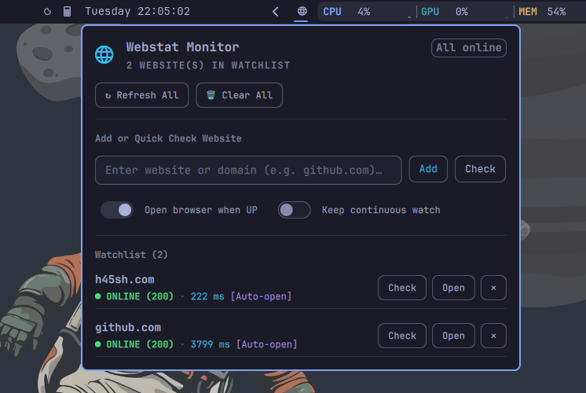

# webstat

[](https://pypi.org/project/webstat/)
[](https://www.python.org/downloads/)
[](https://opensource.org/licenses/MIT)

Fast website status checker, recovery watcher, and desktop reminder for Linux and Omarchy.



`webstat` is designed to solve a simple, frustrating problem: a website or service you are trying to use is down or failing to respond, and you don't want to keep pressing `F5` / `Ctrl+R` manually. You enter the site name; `webstat` checks its status immediately, monitors it in the background if it's down, and reminds you the instant it comes back online with an actionable desktop notification and automatic browser launch.

## Features

- **Instant Check**: Quick one-shot diagnosis (`webstat github.com` or `webstat check mysite.org`).
- **Foreground Watch Mode**: Real-time updating terminal status (`webstat watch downsite.com`).
- **Desktop Recovery Notification**: Dispatches native Omarchy desktop notifications (`omarchy notification send`) or standard `notify-send`.
- **One-Click Browser Launch**: Click the notification or use the `--open` flag to automatically open the site in your default browser once it recovers.
- **Persistent Watchlist**: Queue sites for background monitoring (`webstat add`, `webstat list`, `webstat remove`).
- **Omarchy Shell Integration**: Native top-bar widget and interactive management panel.
- **SSL Certificate Expiry Warnings**: Alerts if TLS certificates are expiring soon.

## Installation

### CLI Installation

```bash
# Recommended: Install from PyPI via pipx
pipx install webstat
# or standard pip:
pip install webstat

# Or install from source:
git clone https://github.com/h45sh/webstat.git
cd webstat
pip install .
```

### Omarchy Shell Plugin Installation
```bash
# Add and enable the plugin in Omarchy
omarchy plugin add https://github.com/h45sh/omarchy-webstat.git --enable
```
Or for local development from this monorepo:
```bash
cp -r plugin ~/.config/omarchy/plugins/h45sh.webstat
omarchy plugin enable h45sh.webstat
```

## Usage


### Quick Status Check
```bash
webstat github.com
webstat check httpbin.org/status/503 --watch
```

### Watching a Site Until Recovery
```bash
# Watch until online and automatically open in browser
webstat watch mysite.com --open

# Watch multiple sites concurrently
webstat watch github.com api.mycorp.internal staging.service.io
```

### Background Watchlist Management
```bash
# Add a site to monitor in background
webstat add api.myservice.com --open

# View current status of all monitored sites
webstat list

# Refresh and test all watched sites immediately
webstat refresh

# Remove a site
webstat remove api.myservice.com

# Clear all watched sites
webstat clear

# Run background watcher daemon directly
webstat daemon
```

## License
MIT © [h45sh](https://github.com/h45sh)
